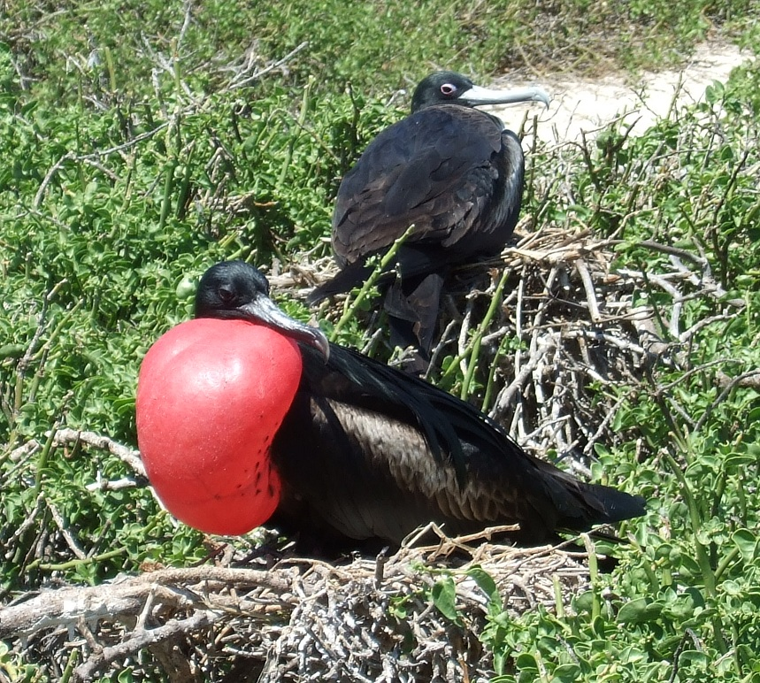
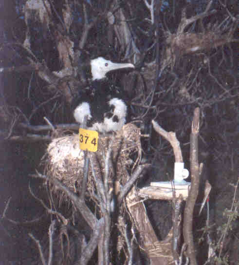

##  Behavioural Ecology

Before studying biology I was already interested in  understanding why animals do what they do and how their behaviour is influenced by the environment, this is what we call Behavioural Ecology, and I have had the chance to explore it in different systems. 

### Seabirds
Seabirds are a quite interesting group because they depend on the sea for food, but they need land for reproduction. 

As a biology student I had the chance to join the Animal Behaviour Lab at the [**Institute of Ecology**](https://www.ecologia.unam.mx/web2/index.php/en/) in Mexico to do research on seabirds for my major.
I studied parental effort in magnificent frigatebirds (*Fregata magnificens*) in a breeding colony in [**Isla Isabel**](https://www.gob.mx/conanp/documentos/parque-nacional-isla-isabel-209449?state=published) in Mexico. 

These seabirds are particular in that their feathers are not quite water proof and therefore they cannot forage by plunging or diving in the sea. Instead, they skim the surface of the sea to grab fish or they steal it from other birds. They also have a long period of parental care - the single chick (females lay only one egg) will still need feeding for between nine months to a year after fledging, which happens at around six months of age, and thus, it can take 18 months for the chick to become fully independent. Although both parents incubate and feed the chick for the first few months, the male deserts the nest before the chick fledges, leaving the burden of finishing raising the offspring to the female. The female compensates the care given by the male after he deserts by increasing the feeding rate to the chick. 

This species, as many other seabirds, is long lived, so trade-offs between current and future reproduction (i. e. survival) may exist. For example, a female frigatebird may decide to also desert the chick if the cost of raising it after the male’s desertion is such that risks her survival and thus her chances of breeding in the future. 

*My research was to study if this increased effort by the female had a cost*, for instance in a reduction on her body mass.  

To do this, we installed an electronic scale that allowed us to record the body mass of the frigatebirds when they came to feed the offspring. We also measured chick-growth before fledging.

It seems that the increase in parental effort after male desertion does not represent a higher reproductive cost for the female, at least measured in terms of body mass, as it did not change before and after male desertion. Chicks attained average growth at fledging, suggesting that the female investment in the current breeding season was enough. 

Nevertheless, as it happens often with ecological research, unpredictable events impacted our field work. Frigatebirds in this colony start courting in late autumn and the first chicks hatch in January/February, when the rainy and hurricane season has ended. However, that year (2001) a jet stream hit the island at the beginning of March and for two days there were strong winds and rain. As most of the chicks were still small and unable to regulate their temperature, the cold and wet conditions caused a high mortality, including 90% of our initial focal sample… The sun did shine afterwards and we started all over again, but with a fewer focal nests. 
