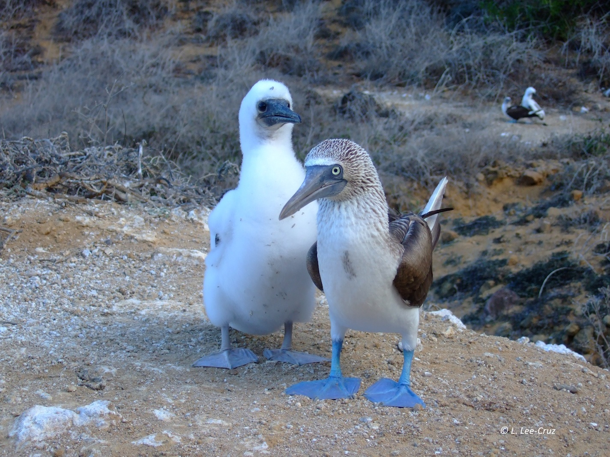

Before studying biology I was already interested in  understanding why animals do what they do and how their behaviour is influenced by the environment, this is what we call Behavioural Ecology, and I have had the chance to explore it in different systems. 

<b>Seabirds</b>

Seabirds are a quite interesting group because they depend on the sea for food, but they need land for reproduction. 

As a biology student I had the chance to join the Animal Behaviour Lab at the [**Institute of Ecology**](https://www.ecologia.unam.mx/web2/index.php/en/) in Mexico to do research on seabirds for my major.
I studied parental effort in magnificent frigatebirds (*Fregata magnificens*) in a breeding colony in [**Isla Isabel**](https://www.gob.mx/conanp/documentos/parque-nacional-isla-isabel-209449?state=published) in Mexico. 

<figure style="float: right; width: 40%; margin: 20px;">
    
    <figcaption style="text-align: left; font-style: italic;">
        Magnificent Frigatebird.
    </figcaption>
</figure>

These seabirds are particular in that their feathers are not quite water proof and therefore they cannot forage by plunging or diving in the sea. Instead, they skim the surface of the sea to grab fish or they steal it from other birds. They also have a long period of parental care - the single chick (females lay only one egg) will still need feeding for between nine months to a year after fledging, which happens at around six months of age, and thus, it can take 18 months for the chick to become fully independent. Although both parents incubate and feed the chick for the first few months, the male deserts the nest before the chick fledges, leaving the burden of finishing raising the offspring to the female. The female compensates the care given by the male after he deserts by increasing the feeding rate to the chick. 

This species, as many other seabirds, is long lived, so trade-offs between current and future reproduction (i. e. survival) may exist. For example, a female frigatebird may decide to also desert the chick if the cost of raising it after the male’s desertion is such that risks her survival and thus her chances of breeding in the future.   
<i>My research was to study if this increased effort by the female had a cost</i>, for instance in a reduction on her body mass.

To do this, we installed an electronic scale that allowed us to record the body mass of the frigatebirds when they came to feed the offspring. We also measured chick-growth before fledging.

It seems that the increase in parental effort after male desertion does not represent a higher reproductive cost for the female, at least measured in terms of body mass, as it did not change before and after male desertion. Chicks attained average growth at fledging, suggesting that the female investment in the current breeding season was enough. 

Later on, I did my PhD at the [School of Biological Sciences](https://biologicalsciences.leeds.ac.uk) of the **University of Leeds** focused on the foraging and breeding ecology of the blue-footed booby (BFB) (*Sula nebouxii*) and its health status in the Galápagos Islands. The initial idea was to study also the Nazca booby (NB) (*Sula granti*). Both seabird species belong to the Sulidae and share some ecological features, but there are differences as well. For instance, siblicide is present in both species, but whereas in the NB it is obligate and the couple only raises one chick, in the BFB it is facultative and sometimes two or even three chicks can fledge in a clutch. Also, the NB are more resilient to changes in the environment because they can delay breeding and can switch their diet if their preferred prey is less abundant. Thus, I wanted to assess if individual differences in health and physiological condition were related to the foraging pattern of breeding adults and if that translated into differences in reproductive success. Comparing both species would provide clues on how they have adapted differently to the same environment. 

However, during my first field season, we realized that BFB breeding numbers in all the islands we visited were much lower than what had been reported 20 years before. This was confirmed by several researchers that had carried out research in the Galápagos for more than a decade; some of them also told me about an apparent lower breeding success. This was even more striking considering that the BFB population in the Galápagos was considered one of the largest for the species in the world. Thus, my research question turned to exploring the *potential causes that could have led to this decline on the BFB*. We focused on two (not mutually exclusive) possible causes: (1) low reproductive success related to poor feeding conditions and (2) poor health. Because of its isolation, many of the animal populations in the Galápagos are vulnerable to pathogens that have been later introduced, such as avian pox. Thus, we were also interested in screening for the presence of parasites. 

I carried fieldwork during three consecutive breeding seasons recording provisioning behaviour to the chicks and reproductive success in two colonies in the archipelago. We also sampled birds to assess their health status and screen for parasites. 

Our results suggested that provisioning of adults to their chicks was less than optimal, resulting in low breeding success and low body mass for surviving chicks, which could have negatively affected their survival later on. In contrast, although we found some evidence of parasites present in the blood, it did not have an effect on provisioning or breeding success, and health status was highly variable within individuals and probably strongly influenced by environmental variables. Overall, our research suggested that poor breeding conditions, possibly related to low food availability in the archipelago, were associated to the decline in this population. A later study confirmed this.

Nevertheless, as it happens often with ecological research, unpredictable events impacted our field work. Frigatebirds in this colony start courting in late autumn and the first chicks hatch in January/February, when the rainy and hurricane season has ended. However, that year (2001) a jet stream hit the island at the beginning of March and for two days there were strong winds and rain. As most of the chicks were still small and unable to regulate their temperature, the cold and wet conditions caused a high mortality, including 90% of our initial focal sample… The sun did shine afterwards and we started all over again, but with a much smaller sample size. 
