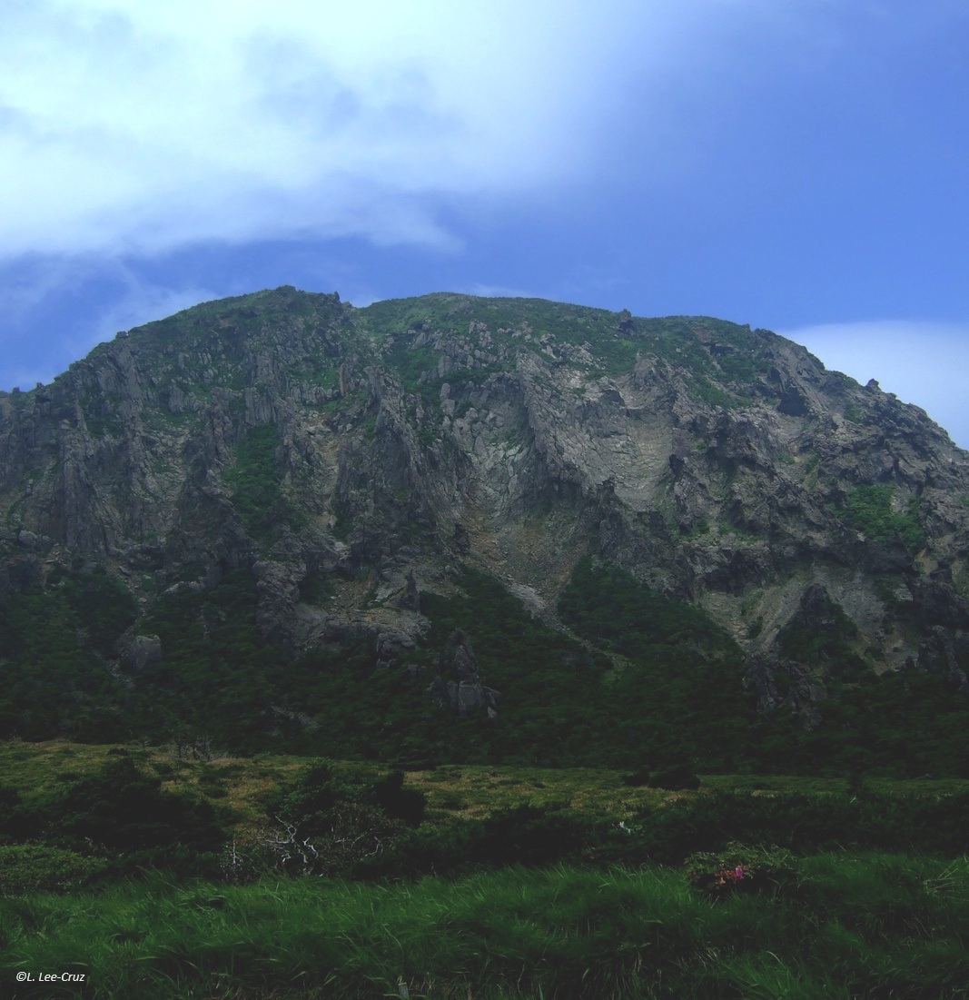
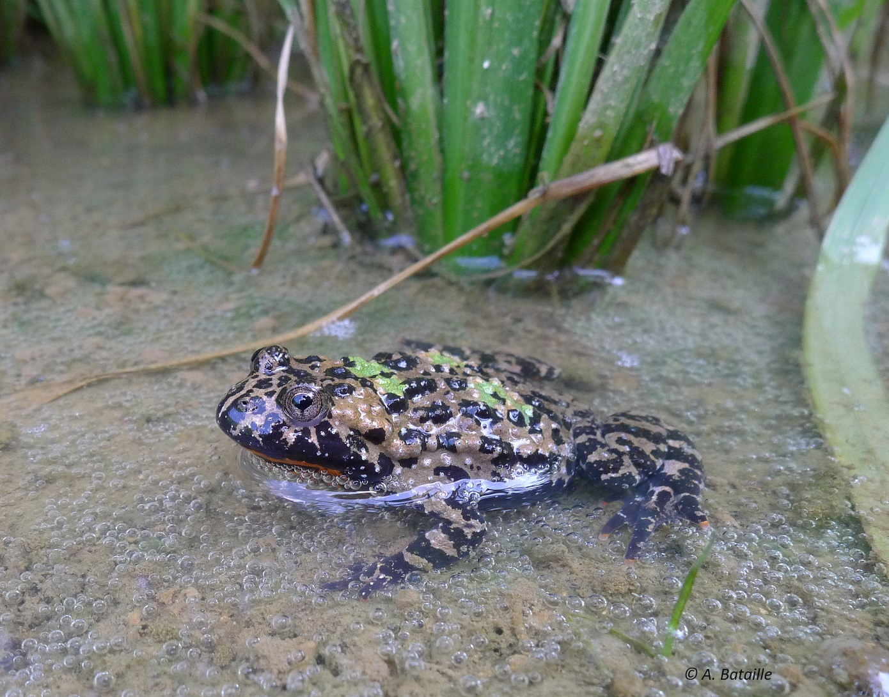
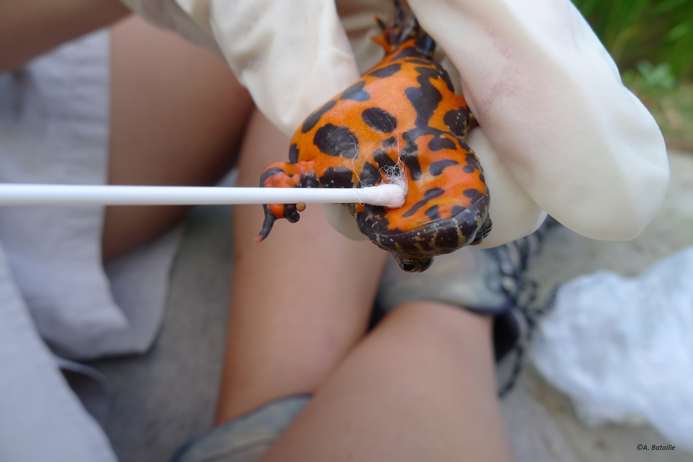

Microbes are present practically everywhere on Earth and they have important roles in ecosystems. For instance, microbes in soil are essential for its structure and function. They influence, for example, water retention and drive nutrient cycling processes, and thus are important for plant growth and ecosystem functioning. Microbes are also important for the functioning of other organisms. In animals, the microbiome influences immune response, metabolism and even behaviour.

I had the opportunity to explore such topics as a postdoc at the [School of Biological Sciences](https://biosci.snu.ac.kr/en) of the Seoul National University where I performed research on community ecology with a focus on bacteria present in soil and amphibian skin. 

<b>Soil bacterial community ecology</b>

Bacteria in soils provide food and nutrients for plants, fungi and invertebrates, among others, and with them they support life of larger organisms. In the lab we characterized the bacterial community in soil samples using high-throughput sequencing. Then, using diverse statistical analyses we assessed how the bacterial community was associated with different environmental factors. 

<figure class="image-left">
    
    <figcaption>
        Mount Halla, Korea
    </figcaption>
</figure>

We studied, for example how the [bacterial diversity and composition changed with elevation](https://doi.org/10.1016/j.soilbio.2013.09.027) in Mount Halla, Korea. These changes were associated with climate variables such as temperature and precipitation. We were also interested in studying if spatial scaling in microbial communities follow the same trend generally observed in plants and animals, which is that at greater distance the community becomes more distinct. [Our study](https://doi.org/10.1007/s00248-014-0404-7) on bacterial community composition of soil in Malaysian tropical rainforest showed that bacterial community dissimilarity was weakly associated to distance at a local but not at a regional scale, and that, in general, variation in the bacterial community is more influenced by the environment than by spatial distance.

Human activities can also impact bacteria in soil and many ecosystems, like tropical rainforests, have been logged or converted for agriculture. Rainforests not only hold a high biodiversity, they are also essential for water cycling, oxygen production or carbon storage, and such ecosystem services depend to a certain extent on soil and the microbes that live in it. To assess the effect of such activities on soil bacteria, we studied a rainforest in Borneo, part of which has been logged or converted to oil palm. We compared α- and β-diversity patterns and community composition in soils of primary forests with those of logged forests and forests converted to oil palm plantations. [Our research](https://doi.org/10.1128/AEM.02541-13) showed that α-diversity was similar among all forests and oil palm plantations, but β-diversity was higher in oil palm plantations with a different community composition compared to primary and logged forests. These results show that oil palm conversion of rainforests impact soil bacterial composition more strongly than logging, and this could have implications for the forest resilience and recovery from such disturbances.

<b>Skin microbiome in frogs</b>

Skin is a very important organ in amphibians because it enables respiration and water and temperature regulation, among other functions. It is populated by a wide variety of bacteria, some of which may help them prevent or fight infections, such as the one caused by the chytrid fungus (*Batrachochytrium dendrobatidis* -*Bd*). This fungus colonizes skin cells causing chytridiomycosis, a disease responsible of population decline in several amphibian species. 

Amphibian development includes an aquatic larval stage and an adult terrestrial stage. For this, they undergo metamorphosis in which various organs go through a dramatic reorganisation. Skin for instance degenerates and is replaced by a multi-layered glandular epidermis. Moreover, differences in thickness, pigmentation and presence of glands arise between the dorsal and ventral skin during metamorphosis. Also, a core skin bacterial community, independent of the environment, can be identified in captive individuals, and this community may influence how amphibians respond to infection. 

With colleagues from the University of Seoul, we studied the microbiome of the fire-bellied toad (*Bombina orientalis*), an Asiatic species present in Korea. We were interested in differences in the microbiome between the dorsal and ventral skin, as these parts are exposed to relatively different environments; also, the ventral part seems to be more susceptible to *Bd* infection. We also studied if the skin microbiome changes with captivity and with *Bd* infection.

<figure class="image-right">
    
    <figcaption>
        Fire-bellied toad
    </figcaption>
</figure>

We sampled fire-bellied toads captured in the wild and toads that had been kept in captivity for at least four months. Samples were used to assess infection by *Bd* and for high-throughput sequencing to identify the microbiome from ventral and dorsal areas. [Our study](https://doi.org/10.1007/s00248-015-0653-0) showed that in this species the bacterial community, including the core bacterial community, differs between the ventral and dorsal skin, but the differences are not the same in captive toads compared to wild ones. Also, bacterial community composition in both regions varied in relation to *Bd* infection, suggesting that the ventral and dorsal skin in fire-bellied toads reacts differently to infection by this fungus. 

We were also interested in looking at how the skin microbiome changes as tadpoles go through metamorphose into froglets. As susceptibility to disease may be affected by the reorganization on the skin microbiome due to metamorphosis, we studied this in tadpoles that were infected with two different *Bd* strains, a native Korean strain to which fire-bellied toad tadpoles are resilient, and the global pandemic lineage associated with amphibian population declines. 

<figure class="image-left">
    
    <figcaption>
        Skin swabbing of a fire-bellied toad
    </figcaption>
</figure>

We did this in controlled conditions in the lab. Although we had low survival of froglets at the end of our experiment, [we observed changes](https://doi.org/10.1007/s00248-017-1034-7) in the bacterial community between tadpoles and later stages of metamorphosis, with no effect of survival, which suggests that the skin microbiome is also reorganized during metamorphosis. 

These studies show that the skin microbiome in amphibians responds to physiological and environmental factors, and that this may influence their ability to defend themselves against chytrid, or other habitat disturbances like pollution. 

