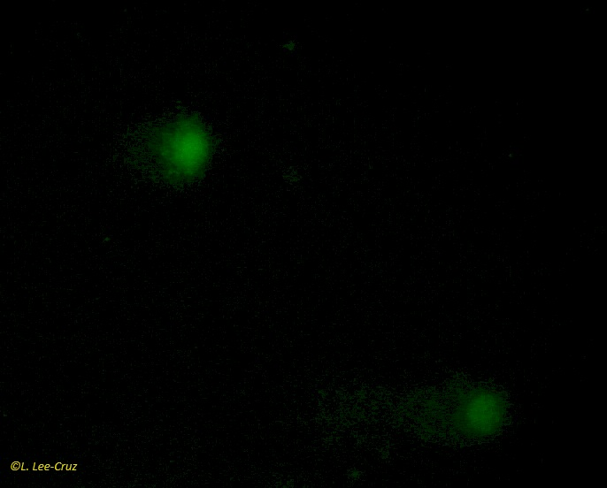
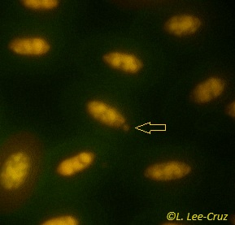

Human activities have released a great amount of toxic chemicals, such as pesticides and heavy metals, into the environment. Ecotoxicology is the discipline in charge of assessing the impacts that toxic chemicals have on life at all levels, from cells in organisms to whole ecosystems. 

<b>Genotoxic damage in people</b>

I joined the [CIBNOR](https://www.cibnor.gob.mx/) in Mexico as postdoctoral fellow to carry out research on genotoxicity, that is the effects of chemicals on the genetic material. We studied the human population in the community of Todos Santos, a village on the Pacific coast of the Baja California Peninsula. In this region, some aquifers are polluted with heavy metals due to mining activities, and locals that drink tap water may be exposed to it. Also, agricultural workers in the village are or have been exposed to pesticides used in the fields. Using the comet assay technique (in which genetic damage appears as the 'tail' of the comet), we assessed the genotoxic damage in buccal cells of people living in Todos Santos, comparing people that consumes well or tap water regularly, with people that have never drank well or tap water from the region. We also took into account if people were or had been agricultural workers exposed to pesticides. The results of [our study](https:// doi: 10.1002/em.22111) showed that genotoxic damage was prevalent in agricultural workers, and that it was also associated with consumption of tap water. This has important implications as this region has one of the highest cancer incidences at the national level, and mining and agriculture are among the main economic activities.

<b>Seabirds as indicators of marine pollution</b>

The Gulf of California holds a remarkable marine biodiversity. However, large agricultural areas are located at the east of the gulf and run-off from farming containing herbicides and pesticides, many of which contain persistent organic pollutants (POPs), ends at sea, affecting this ecosystem. Given that seabirds are top predators of the marine ecosystem and as a result accumulate pollutants in their tissues, they can be used as bioindicators of the areas where they forage. 

A great variety of marine birds breed on the coasts and islands of the Gulf of California, and we wanted to explore if one of them, the brown booby (*Sula leucogaster*), could be used as an indicator of pollution in the Gulf of California. However, to do this we first needed to standardize the techniques to measure genotoxicity in seabirds. Initially we tried to perform the comet assay in lymphocytes isolated from blood. However, genetic material degrades in cells in samples that are not properly preserved. Given that our capacity to process blood and preserve samples in good conditions in the field was limited, we decided that the comet assay would not provide reliable measures of genotoxicity. Instead, we decided to assess genetic damage by estimating the percentage of micronucleus in blood cells. Micronucleus are nuclear aberrations that can be observed in blood smears, after proper staining of the blood. Since blood smears can be easily performed in the field, they are better suited than the centrifugation and preservation required for the comet assay.

  <figure>
    
    <figcaption>Lymphocytes showing genetic damage by comet assay</figcaption>
  </figure>

  <figure>
    
    <figcaption>Micronucleus in blood cells </figcaption>
  </figure>

We collected samples from adult birds on San Jorge and San Pedro Mártir islands, in the Gulf of California, located about 300 km apart, both of which hold breeding colonies of brown boobies. Nuclear aberrations were low in birds from both islands, but in San Jorge, birds had, on average, twice as many as those on San Pedro Mártir. We also measured the concentration of various organochlorines, a type of POP, in blood and plasma extracted from the birds and found variable concentrations in birds from both islands. Further analyses could show if an association exists between genetic damage and organochlorine concentration, and if it differs depending on the island.
